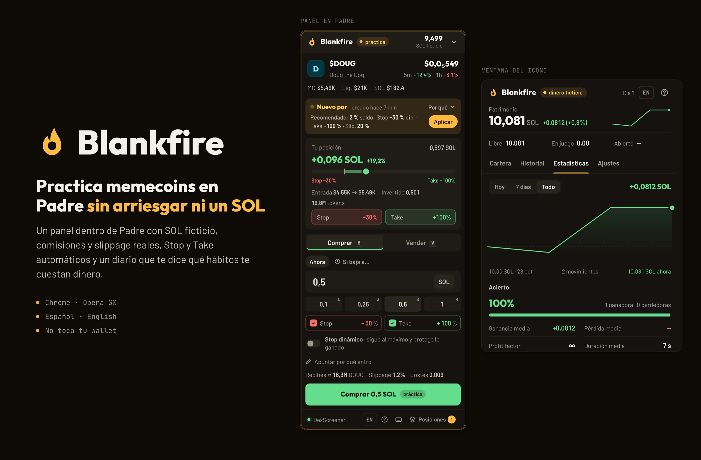

# Blankfire

**Paper trading de memecoins dentro de [Padre](https://trade.padre.gg) (Terminal).** Practica tus trades con SOL ficticio, con los mismos precios, comisiones y slippage que en real, antes de arriesgar tu dinero.

Extensión para Chrome y Opera GX (Manifest V3). Español e inglés.



## Qué hace

- **Panel dentro de Padre** que detecta el token que estás viendo y te deja comprar y vender con SOL ficticio.
- **Simulación realista**: comisión de Padre más la del pool (curva de pump.fun o PumpSwap/Raydium), priority fee (también si la orden falla), slippage calculado con la curva real de pump.fun o la liquidez del pool, retraso de ejecución y rechazo de precios congelados.
- **Stop, Take y stop dinámico** que se ejecutan solos, aunque cierres la pestaña, y **órdenes límite** («compra si baja a…»).
- **Chequeo de monedas**: lee lo que Padre ya enseña (top 10 holders, dev, snipers que siguen dentro, insiders, bundles, liquidez y autoridades del token) y lo marca en verde, ámbar o rojo con el porqué. Etiqueta cada tarjeta de Trenches con «Bien / Ojo / Evitar» y guarda el resultado al comprar para que la revisión avise si entraste en una moneda peligrosa. Umbrales en `lib/screen.js`, con rigor prudente, normal o arriesgado.
- **Ajustes recomendados** según el tipo de token: nuevo par (en la curva de pump.fun) o graduado, explicando el porqué.
- **Diario de trading**: notas de por qué entras y sales, «¿seguiste tu plan?» y etiquetas (FOMO, venganza, con prisa…).
- **Estadísticas**: acierto, profit factor, plan vs. impulso, rachas, costes y un consejo automático.
- **Disciplina**: límite de pérdida diaria que bloquea las compras hasta el día siguiente.
- **Recorridos guiados** del panel y de la ventana, con pasos «Pruébalo» y una compra y venta guiadas que enseñan lo que se llevan las comisiones.
- **Blankfire Pro**:
  - **Qué pasó después**: gráfica del precio desde 20 min antes de entrar hasta 60 min después de vender, con el máximo y el mínimo tras tu venta y cuánto SOL te dejaste (o te ahorraste).
  - **Errores del trade** detectados al momento con reglas claras: entrar persiguiendo la subida, sin stop, posición demasiado grande, vender pronto, stop demasiado ajustado, devolver la ganancia, comisiones, trade de venganza…
  - **Análisis con IA** (Google Gemini): nota de la ejecución, fallos, lo que hiciste bien y una lección para el próximo trade.
- Precios de **DexScreener** y **Jupiter** (para tokens recién creados), con **GeckoTerminal** de respaldo si Jupiter empieza a pedir clave. En Ajustes hay una guía de 4 pasos para conseguir la clave gratuita de Jupiter (developers.jup.ag/portal) y se comprueba al guardarla. No toca tu wallet ni tu cuenta de Padre.

## Instalar (sin empaquetar)

1. Descarga o clona este repositorio.
2. Abre `chrome://extensions` (en Opera GX, `opera://extensions`).
3. Activa el **Modo de desarrollador**.
4. Pulsa **Cargar descomprimida** y elige la carpeta `Fogueo`.
5. Abre un token en [trade.padre.gg](https://trade.padre.gg): el panel aparece solo. <kbd>Alt</kbd>+<kbd>Shift</kbd>+<kbd>F</kbd> lo muestra u oculta.

> La carpeta se llama `Fogueo` (el nombre original del proyecto) a propósito: el navegador identifica la extensión por su ruta, y cambiarla borraría tu cuenta de práctica.

## Actualizar

Cuando se publica una versión nueva aquí, Blankfire te avisa solo: sale una tarjeta en el panel de Padre y en la ventana del icono, y una notificación del sistema. Para actualizar:

1. Haz doble clic en **`actualizar.bat`** (en la carpeta del proyecto). Descarga la versión nueva con Git. Si no usas Git, descarga el [ZIP](https://github.com/lucasusamentiaga/blankfire/archive/refs/heads/main.zip) y reemplaza la carpeta `Fogueo`.
2. Pulsa **Recargar Blankfire** en la tarjeta. La extensión se recarga y Padre se refresca solo. Tu cuenta, posiciones y ajustes se quedan.

En **Ajustes** de la ventana ves tu versión y puedes buscar actualizaciones a mano. Las novedades de cada versión están en [`updates.json`](updates.json).

## Blankfire Pro

«Qué pasó después» y los errores del trade se calculan en tu navegador. El **análisis con IA** pasa por un pequeño servidor de Blankfire ([`server/`](server)), por dos motivos:

- **Legal:** las condiciones de la API de Gemini solo permiten el nivel **de pago** cuando la app se ofrece a usuarios del Espacio Económico Europeo, Suiza o Reino Unido, y la API es para desarrolladores, no para que cada consumidor use su clave. Así que la clave es una sola, la del autor, con facturación activada, y nunca sale del servidor.
- **Candado real:** el servidor comprueba la licencia en Lemon Squeezy antes de cada análisis y pone topes diarios (por licencia y en total) para que el gasto no se dispare. Cada análisis con Gemini Flash-Lite cuesta del orden de una décima de céntimo.

La IA se enciende y se apaga desde aquí mismo, sin publicar versión: en [`updates.json`](updates.json), `"features": { "ai": true }`. Las extensiones lo leen en unas horas. Mientras esté apagada, sale como «Pronto».

> **Saldo de Gemini:** la API de pago de Gemini funciona con **prepago** (mínimo 5 $). Sin saldo, el servidor responde «IA en pausa». Carga el saldo en [AI Studio → Billing](https://aistudio.google.com/billing) antes de encender la IA, y deja desactivada la recarga automática si no quieres cobros sin avisar.

### Donaciones (Ko-fi): la meta que enciende la IA

La extensión muestra una barra «Ayuda a encender el análisis con IA» con lo recaudado en Ko-fi frente a la meta (50 € por defecto). Se actualiza sola: Ko-fi avisa al servidor de Blankfire en cada donación ([`server/supabase/functions/blankfire-kofi`](server/supabase/functions/blankfire-kofi/index.ts)), que guarda solo el importe (ni nombres ni emails).

1. Crea tu página en [ko-fi.com](https://ko-fi.com) (las donaciones no tienen comisión de Ko-fi, solo la de PayPal/Stripe).
2. En Ko-fi → **Settings → API → Webhooks**, pon como URL: `https://ntsjdliklscfbtczmuux.supabase.co/functions/v1/blankfire-kofi`
3. Copia el **Verification Token** de esa misma página y guárdalo en Supabase → Edge Functions → Secrets como `KOFI_TOKEN`.
4. Pon tu enlace de Ko-fi en `SUPPORT.kofiUrl` de [`Fogueo/lib/pro.js`](Fogueo/lib/pro.js).
5. Al llegar a la meta: carga saldo en Gemini y pon `"ai": true` en `updates.json`.

Con el Pro de pago, la gráfica de «Qué pasó después» usa solo el seguimiento propio de Blankfire (precios de DexScreener, cuya API permite uso comercial). Las velas de GeckoTerminal solo se usan en la beta gratuita, porque su API sin clave no incluye licencia comercial.

### Activar la IA (para el autor)

1. Crea un proyecto en [Google Cloud](https://console.cloud.google.com) solo para Blankfire, **activa la facturación** y pon una alerta de presupuesto (p. ej. 5 €/mes).
2. En [AI Studio](https://aistudio.google.com/apikey) crea una clave de API dentro de ese proyecto.
3. En Supabase (un proyecto aparte de tus otras apps es lo más limpio): **SQL Editor** → pega y ejecuta [`server/supabase/blankfire.sql`](server/supabase/blankfire.sql).
4. **Edge Functions** → crea la función `blankfire-ai` con el código de [`server/supabase/functions/blankfire-ai/index.ts`](server/supabase/functions/blankfire-ai/index.ts) y **desactiva «Verify JWT»** (la función hace su propia comprobación).
5. **Edge Functions → Secrets**: añade `BLANKFIRE_GEMINI_KEY` con la clave del paso 2 (y, cuando cobres, `BLANKFIRE_STORE_ID` y `BLANKFIRE_PRODUCT_ID`).
6. Pon la URL de la función en `aiUrl` de [`Fogueo/lib/pro.js`](Fogueo/lib/pro.js) y publica.

### Cobrar el Pro (para el autor)

Mientras `PRO_CONFIG.checkoutUrl` esté vacío, el Pro funciona gratis para todos como **beta** (con la IA limitada a 5 análisis al día por navegador). Para cobrar con [Lemon Squeezy](https://www.lemonsqueezy.com) (de Stripe), que actúa como **vendedor** (*merchant of record*): cobra, factura, gestiona el IVA de cada país y los reembolsos.

1. Crea tu cuenta y tu tienda en Lemon Squeezy y completa la activación (datos para cobrar).
2. Crea un producto «Blankfire Pro» con su precio (pago único o suscripción).
3. En el producto, activa **License keys** y pon un límite de activaciones (p. ej. 2 navegadores).
4. Enlaza en la tienda los [Términos](docs/terminos.md) y la [Privacidad](docs/privacidad.md), después de completar en ellos tu NIF y tu email de contacto.
5. Publica el producto y copia su enlace de compra (**Share**), el número de tu tienda y el del producto.
6. Rellena `checkoutUrl`, `storeId` y `productId` en `Fogueo/lib/pro.js`, y los mismos números en los secretos del servidor.

La extensión activa la licencia con la License API pública de Lemon Squeezy y la vuelve a comprobar cada 3 días (sin conexión sigue valiendo 14). Como el código es abierto, alguien podría saltarse esa comprobación en su copia, pero no conseguiría análisis con IA: eso lo decide el servidor.

> **Antes de la primera venta:** en España, cobrar por un producto de forma continuada suele exigir el alta en Hacienda (modelo 036/037) y, según la habitualidad, en autónomos (RETA). Consúltalo con una asesoría.

## Estructura

```
Fogueo/              La extensión
  manifest.json
  background.js      Service worker: cuenta, precios, simulación, TP/SL y órdenes
  content/           Panel dentro de Padre (Shadow DOM), recorrido guiado y etiquetas de Trenches (scan.js)
  popup/             Ventana del icono: cartera, historial, estadísticas y ajustes
  lib/               Lógica compartida (simulación, formato, Pro: review.js y pro.js) e idiomas
  _locales/          Nombre y descripción en español e inglés
updates.json         Novedades de cada versión (las enseña el aviso de actualización)
actualizar.bat       Descarga la última versión con Git
Marca Blankfire/     Lámina de la marca, filosofía visual y fuentes para regenerar los iconos
server/              Servidor del análisis con IA (Supabase Edge Function + SQL)
docs/                Términos de uso y política de privacidad
tests/               Pruebas de extremo a extremo con Playwright
```

## Pruebas

```bash
cd tests
npm install
npx playwright install chromium
PW_EXPERIMENTAL_SERVICE_WORKER_NETWORK_EVENTS=1 npm test
```

`core.test.mjs` comprueba los cálculos (simulación, curva de pump.fun, formatos y estadísticas) sin navegador. El resto carga la extensión en Chromium, simula las APIs de precios y Padre, y comprueba compras y ventas parciales, recuperar lo invertido, TP/SL, stop dinámico, órdenes límite, límite diario, recorridos en distintas situaciones, casos visuales extremos e idiomas.

## Marca

Llama con un vacío circular: fuego sin pólvora. La lámina muestra su construcción, los tamaños del icono y la paleta; en `Marca Blankfire/` están la filosofía visual y los archivos para regenerarla.


## Tipografías

Todas son libres (SIL Open Font License 1.1) y van incluidas en `Fogueo/fonts/` junto a sus licencias:

- **Outfit ExtraBold**: la marca, los títulos y las cifras grandes.
- **Barlow** y **Barlow Semi Condensed**: el texto y los números del resto de la interfaz.

## Autor

Hecho por **Lucas Usamentiaga**.

- GitHub: [@lucasusamentiaga](https://github.com/lucasusamentiaga)
- Instagram: [@lucasuazz_](https://www.instagram.com/lucasuazz_/)

## Aviso

Blankfire es una herramienta de práctica, solo para mayores de 18 años. Los resultados son una aproximación: en real, la ejecución puede ser peor en tokens muy nuevos o con poca liquidez. Nada de esto es asesoramiento financiero. Blankfire no está afiliado a Padre, pump.fun, Jupiter, DexScreener, GeckoTerminal ni Google. [Términos](docs/terminos.md) · [Privacidad](docs/privacidad.md)
