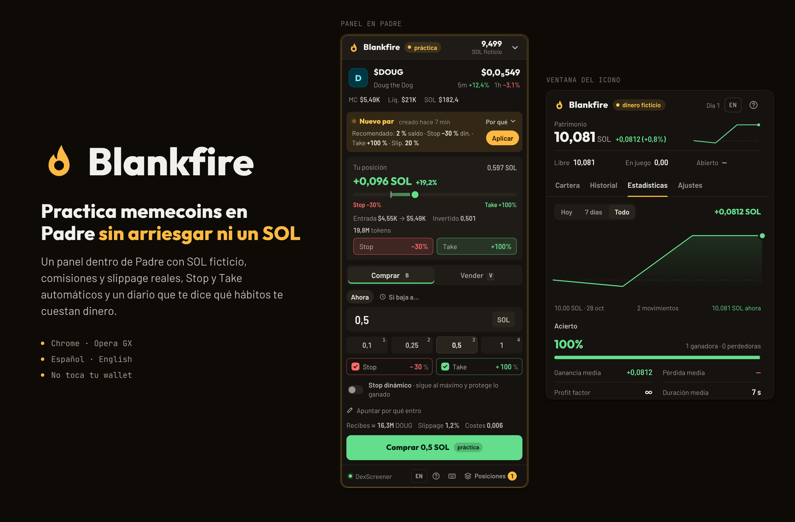

# Blankfire

**Paper trading de memecoins dentro de [Padre](https://trade.padre.gg) (Terminal).** Practica tus trades con SOL ficticio, con los mismos precios, comisiones y slippage que en real, antes de arriesgar tu dinero.

Extensión para Chrome y Opera GX (Manifest V3). Español e inglés.



## Qué hace

- **Panel dentro de Padre** que detecta el token que estás viendo y te deja comprar y vender con SOL ficticio.
- **Simulación realista**: comisión de Padre más la del pool (curva de pump.fun o PumpSwap/Raydium), priority fee (también si la orden falla), slippage calculado con la curva real de pump.fun o la liquidez del pool, retraso de ejecución y rechazo de precios congelados.
- **Stop, Take y stop dinámico** que se ejecutan solos, aunque cierres la pestaña, y **órdenes límite** («compra si baja a…»).
- **Ajustes recomendados** según el tipo de token: nuevo par (en la curva de pump.fun) o graduado, explicando el porqué.
- **Diario de trading**: notas de por qué entras y sales, «¿seguiste tu plan?» y etiquetas (FOMO, venganza, con prisa…).
- **Estadísticas**: acierto, profit factor, plan vs. impulso, rachas, costes y un consejo automático.
- **Disciplina**: límite de pérdida diaria que bloquea las compras hasta el día siguiente.
- **Recorridos guiados** del panel y de la ventana, con pasos «Pruébalo» y una compra y venta guiadas que enseñan lo que se llevan las comisiones.
- Precios de **DexScreener** y **Jupiter** (para tokens recién creados). No toca tu wallet ni tu cuenta de Padre.

## Instalar (sin empaquetar)

1. Descarga o clona este repositorio.
2. Abre `chrome://extensions` (en Opera GX, `opera://extensions`).
3. Activa el **Modo de desarrollador**.
4. Pulsa **Cargar descomprimida** y elige la carpeta `Fogueo`.
   5. Abre un token en [trade.padre.gg](https://trade.padre.gg): el panel aparece solo. <kbd>Alt</kbd>+<kbd>Shift</kbd>+<kbd>F</kbd> lo muestra u oculta.

> La carpeta se llama `Fogueo` (el nombre original del proyecto) a propósito: el navegador identifica la extensión por su ruta, y cambiarla borraría tu cuenta de práctica.

## Estructura

```
Fogueo/              La extensión
  manifest.json
  background.js      Service worker: cuenta, precios, simulación, TP/SL y órdenes
  content/           Panel dentro de Padre (Shadow DOM) y recorrido guiado
  popup/             Ventana del icono: cartera, historial, estadísticas y ajustes
  lib/               Lógica compartida (simulación, formato) e idiomas
  _locales/          Nombre y descripción en español e inglés
Marca Blankfire/     Lámina de la marca, filosofía visual y fuentes para regenerar los iconos
tests/               Pruebas de extremo a extremo con Playwright
```

## Pruebas

```bash
cd tests
npm install
npx playwright install chromium
PW_EXPERIMENTAL_SERVICE_WORKER_NETWORK_EVENTS=1 npm test
```

`core.test.mjs` comprueba los cálculos (simulación, curva de pump.fun, formatos y estadísticas) sin navegador. El resto carga la extensión en Chromium, simula las APIs de precios y Padre, y comprueba compras y ventas parciales, recuperar lo invertido, TP/SL, stop dinámico, órdenes límite, límite diario, recorridos en distintas situaciones, casos visuales extremos e idiomas.

## Marca

Llama con un vacío circular: fuego sin pólvora. La lámina muestra su construcción, los tamaños del icono y la paleta; en `Marca Blankfire/` están la filosofía visual y los archivos para regenerarla.


## Tipografías

Todas son libres (SIL Open Font License 1.1) y van incluidas en `Fogueo/fonts/` junto a sus licencias:

- **Outfit ExtraBold**: la marca, los títulos y las cifras grandes.
- **Barlow** y **Barlow Semi Condensed**: el texto y los números del resto de la interfaz.

## Autor

Hecho por **Lucas Usamentiaga**.

- GitHub: [@lucasusamentiaga](https://github.com/lucasusamentiaga)
- Instagram: [@lucasuazz_](https://www.instagram.com/lucasuazz_/)

## Aviso

Blankfire es una herramienta de práctica. Los resultados son una aproximación: en real, la ejecución puede ser peor en tokens muy nuevos o con poca liquidez. Nada de esto es asesoramiento financiero.
